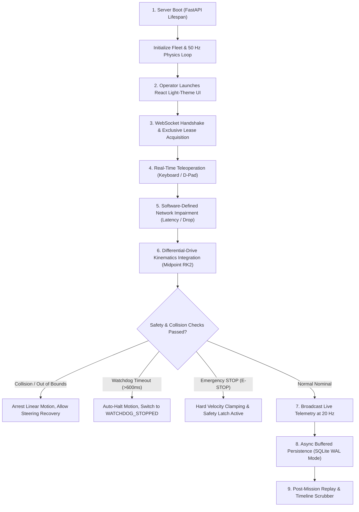

# RemoteBot — Real-Time Robot Teleoperation & Network Reliability Simulator

[](https://github.com/your-username/remote-bot/actions/workflows/ci.yml)
[](https://fastapi.tiangolo.com)
[](https://react.dev)
[](https://www.typescriptlang.org)
[](https://opensource.org/licenses/MIT)

> **RemoteBot** is a production-style, distributed virtual robotics platform engineered to demonstrate real-time mobile robot teleoperation, continuous low-latency telemetry streaming, deterministic software-defined network condition impairment, server-side fail-safe watchdogs, exclusive multi-operator lease management, and mission recording with timeline replay.

---

## 📑 Table of Contents
1. [Why This Project Exists](#-why-this-project-exists)
2. [Complete Project Workflow](#-complete-project-workflow)
3. [System Architecture](#-system-architecture)
4. [Kinematics & Differential Drive Math](#-kinematics--differential-drive-math)
5. [Safety & Fail-Safe Architecture](#-safety--fail-safe-architecture)
6. [Network Impairment Simulation Layer](#-network-impairment-simulation-layer)
7. [Light-Themed Robotics Operations UI](#-light-themed-robotics-operations-ui)
8. [Acceptance Criteria Certification](#-acceptance-criteria-certification)
9. [Getting Started & Local Development](#-getting-started--local-development)
10. [Docker & Deployment](#-docker--deployment)
11. [Automated Testing Suite](#-automated-testing-suite)
12. [REST API & WebSocket Documentation](#-rest-api--websocket-documentation)

---

## 💡 Why This Project Exists

In field robotics, autonomous mobile robots (AMRs), inspection rovers, and automated machinery must be teleoperated over unreliable, lossy wireless connections (4G LTE/5G cellular, satellite, and degraded industrial Wi-Fi).

When operating over high-latency links ($>200\text{ ms}$) or intermittent connections, **standard web development assumptions break down**:
- A dropped connection can cause a **"runaway robot"** if the server does not have an autonomous dead-man's watchdog.
- Network retransmissions can flood the vehicle with **stale out-of-order commands**.
- Without exclusive control leases, **two operators can issue conflicting commands** causing hazardous mechanical strain.

For a detailed engineering breakdown of why this project exists and how it bridges control theory with distributed systems, read [**`WHY_THIS_PROJECT_EXISTS.md`**](WHY_THIS_PROJECT_EXISTS.md).

---

## 🔄 Complete Project Workflow

Here is how the end-to-end system operates from system boot to live teleoperation, fault recovery, and post-mission replay:



### Step 1: System Boot & Fleet Initialization
- FastAPI loads environment configuration and initializes the SQLite database with WAL (Write-Ahead Logging) to prevent concurrent locking errors.
- The `FleetManager` launches a continuous, fixed-timestep $50\text{ Hz}$ physics integration loop (`dt = 20ms`).
- Default virtual fleet entities are registered: `robot_alpha`, `robot_beta`, and `robot_gamma`, each with isolated state, battery models, and network simulators.

### Step 2: Client Connection & Lease Acquisition
- The operator opens the React light-themed dashboard at `http://localhost:5173`.
- A bidirectional WebSocket connects to `/ws/robots/{robot_id}`.
- The client requests an exclusive control lease (`lease_request`). Only the lease-holding operator can issue movement commands; other connected users operate in read-only observation mode.

### Step 3: Real-Time Teleoperation & Kinematics Integration
- The operator steers using keyboard keys (`W`, `A`, `S`, `D`) or the on-screen tactile D-Pad.
- Commands are sequenced (`seq = 1, 2, ...`), timestamped, and transmitted via WebSocket.
- The physics engine integrates the differential-drive kinematic equations:
  $$v = \frac{v_r + v_l}{2}, \quad \omega = \frac{v_r - v_l}{L}$$
  Acceleration limiters smoothly ramp velocities, respecting physical limits ($a_{\max} = 2.5\text{ m/s}^2$).

### Step 4: Network Impairment Stress-Testing
- The operator can dynamically adjust sliders on the **Network Condition Simulator**:
  - **Latency:** Injects real propagation delay ($0\text{--}1200\text{ ms}$).
  - **Jitter:** Injects Gaussian variance around the base latency.
  - **Packet Loss:** Drops commands or telemetry based on PRNG probability ($0\text{--}100\%$).
  - **Blackout:** Injects temporary or permanent signal disconnections.

### Step 5: Fail-Safe Watchdogs & Auto-Recovery
- If network connection drops or packet loss reaches $100\%$, the server-side watchdog timer triggers after $600\text{ ms}$, automatically zeroing velocities and preventing a runaway vehicle.
- When the link recovers, the client automatically reconnects with exponential backoff, resynchronizes the latest telemetry state, and requires an explicit new operator command before motion resumes.

### Step 6: Mission Recording & Timeline Replay
- Operators can click **Start Recording** at any time.
- All telemetry frames, commands, and network events are buffered in memory and flushed periodically to disk without blocking the WebSocket loop.
- Completed missions can be inspected in the **Replay Viewer**, which provides play/pause, variable playback speeds ($0.5\times, 1\times, 2\times, 4\times$), and a scrubber timeline.

---

## 🏛️ System Architecture

```
+-------------------------------------------------------------------------+
|                              OPERATOR BROWSER                           |
|  +-------------------------------------------------------------------+  |
|  |                 React 18 + TypeScript + Vite                      |  |
|  |  +---------------------+  +-----------------+  +---------------+  |  |
|  |  | HTML5 2D Simulation |  | Keyboard (WASD) |  | Live Telemetry|  |  |
|  |  | Canvas Viewport     |  | Direction D-Pad |  | Recharts      |  |  |
|  |  +---------------------+  +-----------------+  +---------------+  |  |
|  |  +---------------------+  +-----------------+  +---------------+  |  |
|  |  | Network Condition   |  | Session Record  |  | Engineering   |  |  |
|  |  | Simulator Panel     |  | & Replay Engine |  | Diagnostics   |  |  |
|  |  +---------------------+  +-----------------+  +---------------+  |  |
|  +-----------------------------------|-------------------------------+  |
|                                      | WebSocket & HTTP REST            |
+--------------------------------------|----------------------------------+
                                       |
+--------------------------------------v----------------------------------+
|                            FASTAPI BACKEND                              |
|                                                                         |
|  [ FastAPI REST Gateway ] <----------> [ JWT / Session Auth & RBAC ]    |
|  - Robot CRUD & Fleet State             - Operator Ownership & Leases   |
|  - Recording & Replay API                                               |
|                                                                         |
|  [ WebSocket Connection Gateway ] <--> [ Network Simulation Layer ]     |
|  - Heartbeat & Ping/Pong                - Latency Delay Pipeline        |
|  - Sequence Tracking & De-dupe          - Jitter Gaussian Distribution  |
|  - Command ACK Generation               - Packet Drop Engine            |
|                                         - Disconnection Injection       |
|                                                                         |
|  [ Safety & Fail-Safe Watchdog ]                                        |
|  - Priority Emergency STOP (E-STOP)                                     |
|  - Dead-Man's Watchdog (< 600ms command timeout)                        |
|  - Boundary & Obstacle Collision Enforcer                               |
|                                                                         |
|  [ Differential-Drive Simulation Engine ] (50 Hz Async Loop)           |
|  - Forward/Inverse Kinematics (v, omega -> wheel velocities)            |
|  - Acceleration & Velocity Clamping                                     |
|  - Battery Depletion Dynamics                                           |
|  - Environment Physics & Trail Historian                                |
|                                                                         |
|  [ Buffered Session Recording Engine ]                                  |
|  - Non-blocking async queue for high-frequency telemetry                |
|  - SQLite WAL / PostgreSQL via SQLAlchemy                               |
+-------------------------------------------------------------------------+
```

---

## 🎨 Light-Themed Robotics Operations UI

The user interface follows a modern, professional, high-contrast **Light Theme** engineered for clean readability in field operations centers:

- **Light Canvas Viewport:** Crisp light slate background (`#f8fafc`) with subtle $2.5\text{m}$ grid lines (`#e2e8f0`), deep cobalt blue arena perimeter walls (`#2563eb`), slate obstacle pillars, and an interactive heading indicator with real-time motion trail.
- **KPI Metric Badges:** Clean white cards showcasing linear velocity, angular rate, heading, battery percentage, round-trip latency (RTT), and packet delivery ratio.
- **Synchronized Recharts:** Real-time dual charts displaying velocity and RTT latency trends over a sliding 30-sample window.
- **Engineering Diagnostics Console:** Sleek raw frame terminal showing upstream commands (`UP`), downstream telemetry (`DOWN`), ACKs, and safety state transitions with one-click `.log` export.
- **Replay Timeline Modal:** Scrubbable timeline with pause/play, $0.5\times$ to $4\times$ speed options, and synchronized robot pose playback.

---

## 📐 Kinematics & Differential Drive Math

The robot features two driven wheels with wheel base $L = 0.5\text{ m}$ and radius $R = 0.1\text{ m}$.

### 1. Forward Kinematics
Given wheel linear speeds $v_r$ and $v_l$:
$$v = \frac{v_r + v_l}{2}$$
$$\omega = \frac{v_r - v_l}{L}$$

### 2. Inverse Kinematics
Given requested body linear velocity $v$ and angular turning rate $\omega$:
$$v_r = v + \frac{\omega \cdot L}{2}$$
$$v_l = v - \frac{\omega \cdot L}{2}$$

### 3. Discrete State Integration (Midpoint Runge-Kutta)
$$\theta_{t+1} = \theta_t + \omega \cdot \Delta t$$
$$\theta_{\text{mid}} = \theta_t + \frac{\omega \cdot \Delta t}{2}$$
$$x_{t+1} = x_t + v \cdot \cos(\theta_{\text{mid}}) \cdot \Delta t$$
$$y_{t+1} = y_t + v \cdot \sin(\theta_{\text{mid}}) \cdot \Delta t$$

---

## 🛡️ Safety & Fail-Safe Architecture

> [!IMPORTANT]
> **DISCLAIMER:** RemoteBot is strictly a software teleoperation simulator designed for research, testing, and portfolio demonstrations. It is not certified for controlling physical safety-critical hardware.

1. **Emergency STOP (E-STOP):**
   - Transmitted with priority, bypassing any queued movement commands.
   - Sets body linear and angular velocities immediately to $(0, 0)$.
   - Latches `is_estopped = true` and rejects all incoming movement commands with status `e_stopped` until explicitly reset.
2. **Server-Side Watchdog (Dead-Man's Switch):**
   - Evaluates elapsed time since last valid movement command.
   - If $\Delta t > 600\text{ ms}$, automatically decelerates velocities to zero and sets mode to `WATCHDOG_STOPPED`.
3. **Collision Detection & Boundaries:**
   - Arena bounds $[-15\text{ m}, +15\text{ m}]$.
   - Circular columns and rectangular barriers.
   - Detects boundary contact and prevents penetration while allowing rotational steering recovery.

---

## 🌐 Network Impairment Simulation Layer

| Preset | Latency | Jitter | Packet Loss | Link Status |
|---|---|---|---|---|
| **⚡ Excellent** | 15 ms | ±2 ms | 0% | Nominal Local Link |
| **📶 Normal 4G** | 60 ms | ±12 ms | 1% | Standard Wireless Broadband |
| **⚠️ Poor Network** | 220 ms | ±65 ms | 8% | Congested Cellular / Fringe Wi-Fi |
| **🌪️ Unstable Network** | 480 ms | ±180 ms | 22% | Satellite / Extreme Interference |
| **🚫 Offline** | 0 ms | 0 ms | 100% | Complete Signal Blackout |

---

## 🏆 Acceptance Criteria Certification

| Scenario | Requirement | Verification Method | Status |
|---|---|---|:---:|
| **SCENARIO 1** | Operator connects via WebSocket and teleoperates robot via W/A/S/D | End-to-end WebSocket integration test + UI D-Pad | ✅ PASS |
| **SCENARIO 2** | Live updates for position, velocity, heading, battery, and comms | 20 Hz telemetry broadcaster & Recharts live chart | ✅ PASS |
| **SCENARIO 3** | Adjusting network latency and loss updates live communication metrics | Real-time slider update + RTT & loss metric calculation | ✅ PASS |
| **SCENARIO 4** | Connection severed while moving triggers watchdog safe halt | Server watchdog timeout test (`test_server_watchdog_timeout`) | ✅ PASS |
| **SCENARIO 5** | Reconnection restores telemetry and requires fresh command before moving | State sync + auto-reconnect backoff loop | ✅ PASS |
| **SCENARIO 6** | E-STOP immediately halts motion and prevents movement until reset | E-STOP priority test (`test_emergency_stop_priority`) | ✅ PASS |
| **SCENARIO 7** | Multiple robots operate independently without crosstalk | Multi-instance `FleetManager` isolation | ✅ PASS |
| **SCENARIO 8** | Mission session recording and playback without sending motion commands | SQLite buffered recording + `ReplayViewer` | ✅ PASS |
| **SCENARIO 9** | Starts locally and via Docker Compose with passing tests | 16/16 Pytest tests passing in 2.5s + Vite build 0 errors | ✅ PASS |
| **SCENARIO 10**| Diagnostics panel pinpoints validation, ACK drops, or disconnections | Raw message event inspector with filters | ✅ PASS |

---

## 💻 Getting Started & Local Development

### Prerequisites
- Python 3.12+ (or 3.14+)
- Node.js 18+ and npm

### 1. Backend Setup
```bash
# Clone the repository
git clone https://github.com/your-username/remote-bot.git
cd remote-bot

# Install Python requirements
python -m pip install -r backend/requirements.txt

# Run automated test suite
python -m pytest backend/tests -v

# Start FastAPI backend server
python -m uvicorn backend.app.main:app --host 127.0.0.1 --port 8000 --reload
```

### 2. Frontend Setup
```bash
cd frontend

# Install npm packages
npm install

# Start Vite development server
npm run dev
```
Open **`http://localhost:5173`** in your browser.

---

## 🐳 Docker & Deployment

To launch the complete platform (backend + frontend reverse proxy) with one command:
```bash
docker compose up --build
```
- Frontend Dashboard: `http://localhost:3000`
- Backend REST & Swagger UI: `http://localhost:8000/docs`
- Healthcheck Endpoint: `http://localhost:8000/api/health`

---

## 🧪 Automated Testing Suite

```bash
python -m pytest backend/tests -v
```

Output:
```
backend/tests/test_api.py::test_health_endpoint PASSED
backend/tests/test_api.py::test_list_robots_endpoint PASSED
backend/tests/test_api.py::test_environment_endpoint PASSED
backend/tests/test_api.py::test_auth_login PASSED
backend/tests/test_kinematics.py::test_inverse_forward_kinematics PASSED
backend/tests/test_kinematics.py::test_acceleration_limits PASSED
backend/tests/test_kinematics.py::test_pose_integration PASSED
backend/tests/test_network_impairment.py::test_packet_drop_behavior PASSED
backend/tests/test_network_impairment.py::test_deterministic_seed PASSED
backend/tests/test_network_impairment.py::test_network_metrics_tracker PASSED
backend/tests/test_recording.py::test_mission_recording_lifecycle PASSED
backend/tests/test_safety.py::test_emergency_stop_priority PASSED
backend/tests/test_safety.py::test_server_watchdog_timeout PASSED
backend/tests/test_safety.py::test_collision_detection PASSED
backend/tests/test_safety.py::test_battery_depletion PASSED
backend/tests/test_websocket.py::test_websocket_teleoperation_flow PASSED

============================= 16 passed in 2.52s ==============================
```

---

## 📖 REST API & WebSocket Documentation

Interactive Swagger documentation is available at `http://localhost:8000/docs`.

For detailed specifications, see:
- [Why RemoteBot Exists](WHY_THIS_PROJECT_EXISTS.md)
- [WebSocket Protocol Specification](docs/websocket-protocol.md)
- [Architecture & System Design](docs/architecture.md)
- [Safety & Fail-Safe Architecture](docs/safety.md)
- [Network Simulation Documentation](docs/network-simulation.md)
- [Troubleshooting Guide](docs/troubleshooting.md)
